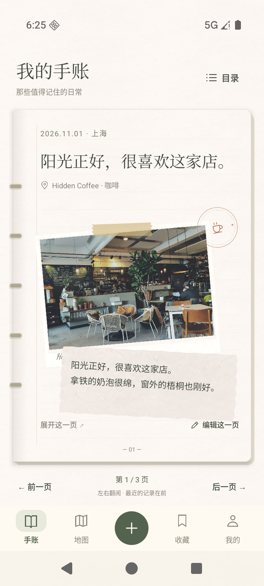
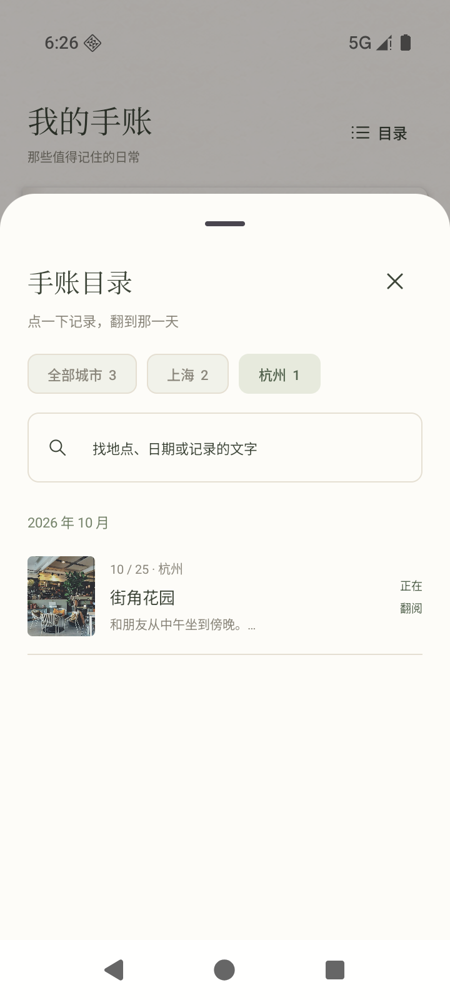

# My Little Atlas · 私藏去处

一款私人的城市收藏图鉴：把想去的地方，慢慢变成去过的地方。

App 使用 **Kotlin Compose Multiplatform**，Android、iOS 与桌面 JVM 共用界面和业务逻辑，平台适配层负责系统图片选择、文件备份、分享与导航。

## 项目内容

- [App 源码、功能说明与构建方式](my_little_atlas/README.md)
- [调研与设计方案](My_Little_Atlas_调研与设计方案.md)
- [中国市场调研](My_Little_Atlas_中国市场调研_2026-11-06.md)
- [市场调研样本与来源清单](market_research_2026-11-06/)
- [视觉参考图](my_little_atlas_scrapbook_concept.png)

底栏为「手账 / 地图 / ＋ / 收藏 / 我的」。手账直接展示到访记录，目录可按城市查找并跳页；中间「＋」提供写小记与收藏地点。收藏按城市及想去/去过筛选，个人页保留大封面布局，城市统计直接在地图查看。

## Android 模拟器实拍




最新改版与验证记录：[简化动线与城市分类落地](design/atlas-ui-handoff-v2/implementation/简化动线与城市分类落地.md)。

## 本地构建

准备 JDK 17+ 与 Android SDK 36，在 `my_little_atlas` 目录运行：

```powershell
.\gradlew.bat :composeApp:assembleDebug
.\gradlew.bat :composeApp:test
.\gradlew.bat :composeApp:run
```

在本机 `local.properties` 中配置 `sdk.dir`。APK、桌面 JAR、工具链缓存、模拟器磁盘和签名文件仅保存在本地，不纳入源码版本管理。

## 当前范围

Android 调试 APK 已在 Android 16 模拟器安装运行；桌面 JVM 源码已通过编译。已接入原生真实地图与“小红书链接 → 识别店名 → 高德核对 → 明确选择收藏 → 地图标记”流程，解析与门店查询使用本机 API 服务。iOS 已加入相同 Compose 页面和 Swift 原生能力适配，使用 macOS CI 编译和截图测试，详见 [iOS 工程](my_little_atlas/iosApp/README.md)。真机安装需要 Apple 签名。
