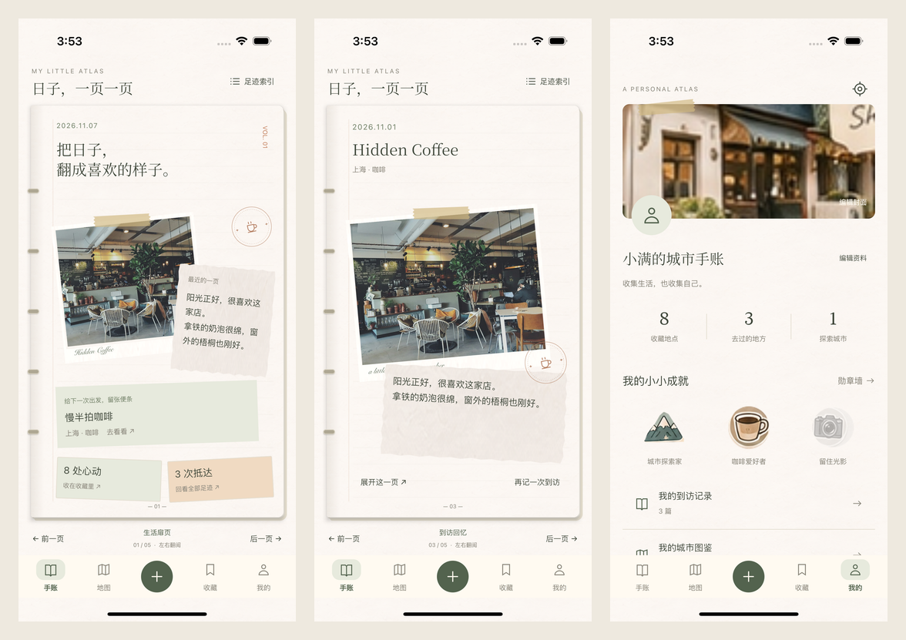

# iOS 构建交付

## 实现范围

iOS 与 Android 直接使用同一套 Kotlin Compose 页面、字体和素材。保留 V3 手账首页、横向翻页与不规则纸片排版，以及用户最终选择的 ProfileV2：大封面、圆头像、昵称签名、三列数据、勋章和功能列表。

底部入口仍为「手账 / 地图 / ＋ / 收藏 / 我的」。iOS 单独接入相册选择和保存、文件导入导出、系统分享、文字/链接分享扩展、定位、地图导航和网络请求。最低系统 iOS 16。

## 可下载产物

源码版本：`973f83e6d5b64f22080741973c52abe7820092c0`。

本地目录：`my_little_atlas/dist/ios/`。

| 文件 | 用途 | 大小 | SHA-256 |
| --- | --- | --- | --- |
| MyLittleAtlas-unsigned.ipa | iPhone / iPad ARM64 Release，未签名 | 31,409,480 bytes | E8697711FE51C5E3AE47FA42883382427F804BC9592C27014FC0E8772008B826 |
| MyLittleAtlas-simulator.app.zip | Apple Silicon Mac 的 iOS 模拟器 | 36,860,952 bytes | 84AA60EAE8C09E16906DB20D864FDCFF49DFA19F2131936D3745675921C3DC8D |

[GitHub 构建产物](https://github.com/OscarDeng1029/mark-place/actions/runs/42386455056/artifacts/13581043548)。已核对 ZIP 结构、ARM64 Mach-O 文件头、主应用、分享扩展、Info.plist 和隐私清单。

未签名 IPA 不能直接安装到普通 iPhone。真机运行或 TestFlight 分发需在 Xcode 配置自己的 Apple Development Team、签名及主应用/分享扩展的 App Group；详见 [iOS 构建说明](../../../my_little_atlas/iosApp/README.md)。本次没有发布到 TestFlight / App Store。

## 验证结果

- macOS、Xcode 16.4：iPhone ARM64 Release 编译成功。
- iOS 18.5 / iPhone 16 Pro 模拟器：XCUITest 1 项端到端测试通过，0 失败，耗时 76.4 秒。覆盖手账翻页、切换页面后页码保留、收藏、最终保留的个人页、编辑资料和草稿入口。
- iOS 共享业务测试：14 项，0 失败。
- 桌面共享业务测试：14 项，0 失败。
- Windows Android Debug / 桌面编译回归通过。

测试使用 DEBUG 专属的独立示例库；截图展示的是测试数据。没有读取或重置 Android 用户记录。iOS 正式安装从空库开始，不会自动同步 Android 本地记录。

[构建运行与日志](https://github.com/OscarDeng1029/mark-place/actions/runs/42386455056)。该次运行的全部构建、测试与产物上传步骤成功，但在最后的缓存清理阶段触及 60 分钟总超时，GitHub 将整体运行标为 cancelled。仓库已将后续运行的超时上调至 120 分钟；本次产物和测试结果已成功保存，不能将该次工作流描述为整体全绿。

## 原生模拟器截图

原始截图：

1. [手账首页](screenshots/ios/01-journal-opening.png)
2. [心愿页](screenshots/ios/02-journal-wishes.png)
3. [到访回忆](screenshots/ios/03-journal-memory.png)
4. [收藏](screenshots/ios/04-collections.png)
5. [最终保留的个人页](screenshots/ios/05-original-profile.png)
6. [编辑资料](screenshots/ios/06-edit-profile.png)
7. [草稿](screenshots/ios/07-drafts.png)

截图来自真实运行的 iOS 模拟器，不是设计稿。图片中系统状态栏与底部安全区由 iOS 提供。
